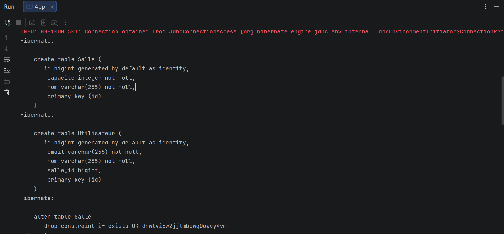
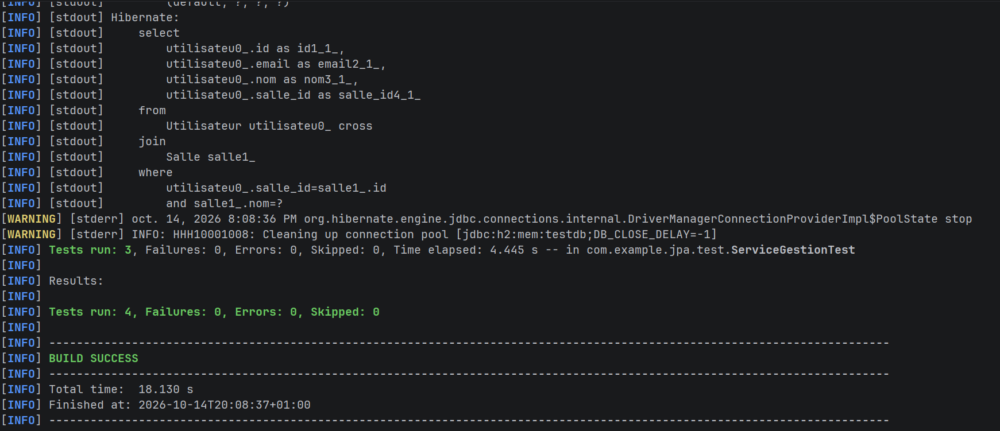

## Résultats

### 1. Exécution de l'application (App)

Explication : ...

### 2. Résultat des tests (mvn test)

Explication : ...
### 1. Exécution de l'application (`App`)

Cette capture montre le démarrage d'Hibernate lors du lancement de `App`.
Grâce à `hibernate.hbm2ddl.auto=create-drop`, Hibernate génère automatiquement le schéma
SQL à partir des entités JPA :

- **Table `Salle`** : `id` (clé primaire auto-générée), `capacite` (entier, non nul) et
  `nom` (texte, non nul).
- **Table `Utilisateur`** : `id`, `email`, `nom` (non nuls) et `salle_id`, la clé étrangère
  issue de la relation `@ManyToOne` vers `Salle`.
- Les instructions `alter table ... drop constraint if exists` puis `add constraint`
  servent à poser les contraintes d'unicité (nom de la salle, email de l'utilisateur) et la clé étrangère.

Les lignes `INFO` en rouge ne sont pas des erreurs : c'est la sortie du logger Hibernate
sur le flux d'erreur standard.

### 2. Résultat des tests (`mvn test`)

Cette capture montre l'exécution de la suite de tests JUnit avec Maven :

- La requête SQL affichée correspond à `findBySalleNom` : Hibernate traduit la JPQL
  `u.salle.nom = :nom` en une jointure entre `Utilisateur` et `Salle`
  (`salle_id = salle1_.id and salle1_.nom = ?`). Elle valide le test
  `testRechercheUtilisateursParSalle`.
- `Tests run: 3, Failures: 0, Errors: 0` pour `ServiceGestionTest` : les trois tests
  (création de salle, création d'utilisateur avec salle, recherche par salle) passent.
- `Tests run: 4` au total : le 4ᵉ test est celui généré par Maven dans une autre classe.
- `BUILD SUCCESS` : le projet compile et tous les tests réussissent (durée : 18 s).
- Le message `Cleaning up connection pool` confirme la fermeture propre de la connexion
  à la base H2 en mémoire (`service.fermer()` dans `@After`).
